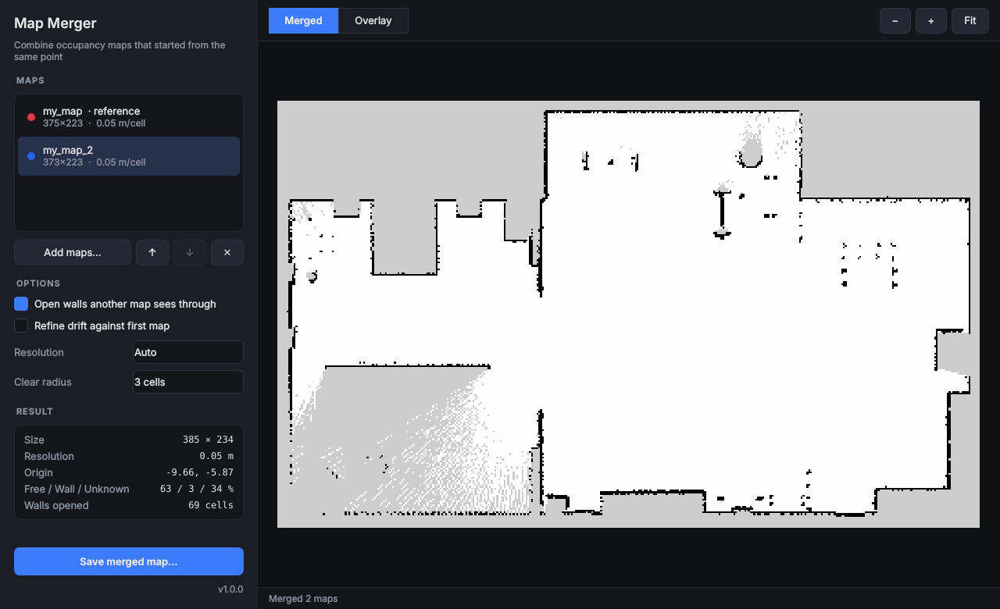
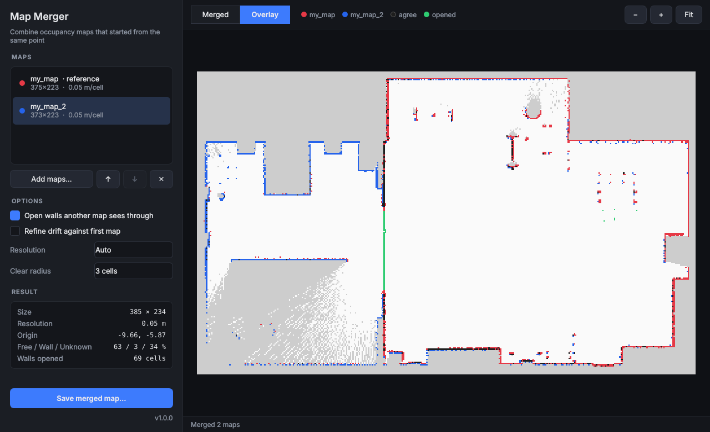

# Map Merger

Desktop app (and command line tool) to merge ROS occupancy grid maps into one map.

If you mapped the same place in several runs, each starting from the **same point**, the maps
already share one world frame. Map Merger places each map using the `origin` and `resolution`
from its YAML, combines them cell by cell, and saves a normal `.pgm` + `.yaml` that
`map_server` / nav2 can load directly.



## Features

- Merge 2 or more maps, any size, any origin (rotation in the origin is handled too)
- Live preview with zoom and pan, the map updates as you change options
- **Overlay view** to check alignment: each map's walls get their own colour
- Opens up walls that another run saw through (for example a door that was closed in
  one run and open in another)
- Optional drift fix (ECC image registration) with a safety limit, so a bad match is ignored
- Cursor readout in world coordinates (metres) and cell state
- Drag and drop `.yaml` files onto the window
- Same merge from the command line for scripts



*Overlay view: red = `my_map`, blue = `my_map_2`, dark = walls both maps agree on,
green = wall from one map that was opened because the other map saw through it.*

## Install

Needs Python 3.9 or newer. Tested on Ubuntu 22.04 / 24.04.

```bash
git clone https://github.com/srivatsa-dotcom/map_merger.git
cd map_merger

python3 -m venv .venv
source .venv/bin/activate
pip install .
```

This installs two commands into the venv:

| command      | what it is            |
|--------------|-----------------------|
| `map-merger` | the desktop app       |
| `map-merge`  | the command line tool |

To run without installing: `pip install -r requirements.txt`, then `python3 -m map_merger`
for the app or `python3 -m map_merger.cli` for the command line tool.

## Using the app

```bash
source .venv/bin/activate
map-merger
```

You can also pass maps straight away: `map-merger examples/my_map.yaml examples/my_map_2.yaml`

1. **Add maps.** Click *Add maps…* (or Ctrl+O) and pick the `.yaml` files from `map_saver`.
   You can also drag them onto the window. Add at least two.
2. **Check the Merged view.** It shows the map that will be saved. Scroll to zoom, drag to
   pan, *Fit* to reset.
3. **Check the Overlay view.** If walls from different maps sit on top of each other, the
   maps are aligned. If they are clearly shifted, turn on *Refine drift against first map*.
4. **Save.** Click *Save merged map…* (or Ctrl+S) and pick a name. You get `name.pgm` and
   `name.yaml` next to each other.

### Options

| option | what it does |
|---|---|
| **Open walls another map sees through** | On by default. If one map has a wall and another map clearly sees open space at the same spot, the cell becomes free. Turn off to keep every wall from every map. |
| **Refine drift against first map** | Corrects a small shift/rotation between runs using image registration. Every map is aligned to the first one in the list, so put your best map first (↑ ↓ buttons). Corrections bigger than 0.5 m or 5° are rejected. Leave this off unless the overlay shows a mismatch. |
| **Resolution** | Output cell size. *Auto* uses the finest input map. |
| **Clear radius** | How far (in cells) a map has to be from its own wall before it is allowed to open another map's wall. This protects real walls when maps are 1–2 cells apart. Raise it if real walls get erased. |

## Command line

```bash
map-merge my_map.yaml my_map_2.yaml -o merged_map
map-merge map1.yaml map2.yaml map3.yaml map4.yaml -o merged_map --debug
```

| flag | meaning |
|---|---|
| `-o NAME` | output name, writes `NAME.pgm` and `NAME.yaml` (default `merged_map`) |
| `--resolution R` | output resolution in metres (default: finest input) |
| `--refine` | fix small drift against the first map |
| `--keep-all-walls` | dont open walls that another map sees through |
| `--radius N` | clear radius in cells (default 3) |
| `--debug` | also save `NAME_overlay.png` |

## Using the merged map with ROS

ROS 2 / nav2:

```bash
# with the nav2 bringup
ros2 launch nav2_bringup bringup_launch.py map:=/full/path/merged_map.yaml

# or just the map server (it is a lifecycle node, so activate it after starting)
ros2 run nav2_map_server map_server --ros-args -p yaml_filename:=/full/path/merged_map.yaml
ros2 lifecycle set /map_server configure
ros2 lifecycle set /map_server activate
```

ROS 1:

```bash
rosrun map_server map_server merged_map.yaml
```

The merged map has a new `origin`, because the canvas grows to fit every map. World coordinates
do not change, so a pose that was valid in your old maps is still valid in the merged one, and
the robot starts at the same spot as before.

## How it works

1. **Load.** Each image is read the same way `map_server` reads it (`negate`,
   `occupied_thresh`, `free_thresh`). Grey `205` pixels from `map_saver` are always treated as
   unknown.
2. **Place.** Every map is placed in the shared world frame using its own `origin` (x, y, yaw)
   and `resolution`. The output canvas is the bounding box of all maps plus a small border.
3. **Refine (optional).** ECC image registration estimates a small rigid correction of each map
   against the first. Large answers are thrown away, because maps from the same start point
   should only differ by a little drift.
4. **Combine.** For every cell:
   - a wall in some map, but another map clearly sees open space there → **free**
   - otherwise a wall in any map → **wall**
   - free in any map → **free**
   - else → **unknown**

   "Clearly sees open space" means the cell is free in that map, that map has no wall of its own
   within the clear radius, and at least 60% of the 7×7 area around it is free.

## Requirements for your maps

- All maps were started from the same point (same `map` frame). The tool does not search for an
  unknown offset between maps; it only fixes small drift.
- Map images are `.pgm` or `.png`, with a YAML in the standard `map_server` format.

## Troubleshooting

**`qt.qpa.plugin: Could not load the Qt platform plugin "xcb"`**
Usually `opencv-python` (the non-headless one) is installed in the same environment and brings
its own Qt. Use the venv above, or run `pip uninstall opencv-python` and keep only
`opencv-python-headless`. On a fresh Ubuntu you may also need `sudo apt install libxcb-cursor0`.

**`error: externally-managed-environment` when running pip**
Ubuntu 23.04+ blocks system-wide pip installs. Use the venv steps from Install.

**A real wall disappeared in the merged map**
Raise *Clear radius* (or `--radius`), or turn off *Open walls another map sees through*.

**Walls are doubled or shifted in the overlay**
Turn on *Refine drift*. If the note under Result says the correction was rejected, the drift is
larger than this tool is meant to fix. Check that the maps really started from the same point.

## Building the app

`bash packaging/build.sh` builds a single-file app into `dist/` with PyInstaller.
Build on the oldest Ubuntu you want to support (a build made on 24.04 will not start on 22.04).

The GitHub Actions workflow in `.github/workflows/build.yml` does this on Ubuntu 22.04
(x86_64 and arm64 for Jetson) and Windows. It runs when you push a tag like `v1.0.0`, or by
hand from the Actions tab. The finished apps are under the run's *Artifacts*.

## License

Proprietary freeware, see [LICENSE](LICENSE). The app is free to use; the source code is not
public and may not be copied or redistributed.

## Project layout

```
map_merger/
  core.py      merge logic (load, place, refine, combine, save)
  gui.py       desktop app (PySide6)
  cli.py       command line tool
examples/      two sample maps to try it with
tests/         pytest tests for the merge logic
docs/          screenshots
packaging/     pyinstaller entry point and build script
```

Run the tests with `pip install pytest && pytest`.
